<p align="center">
  <a href="https://literary-quill.streamlit.app">
    
  </a>
</p>

<p align="center">
  <a href="https://literary-quill.streamlit.app"></a>
</p>

<p align="center"><i>For the girls who annotate their books, keep a journal by the bed,<br>and believe a good story deserves a beautiful place to live.</i></p>

<p align="center"></p>

Hello, lovely reader. 🌸

**Literary Quill** is your gentle reading companion, like a best friend who has read every book on your shelf and never minds a hundred questions. Bring her your latest novel, a chapter for book club, an essay for class or the notes you've been meaning to make sense of. She'll read alongside you, chat about the characters, and help you find the lines worth underlining.

Light a candle, pour your favourite tea, and settle in. Soft pink skies, drifting white feathers, and a quill that writes beside you as you journal your thoughts. No rush. No noise. Just you, your story and a little magic. ✨

<!-- Tip: add a screenshot of the app as assets/screenshot.png and remove the comment marks below
<p align="center"></p>
-->

<p align="center"></p>

<h2 align="center">What awaits you, darling</h2>

<table>
  <tr>
    <td width="50%" valign="top">
      <h3>📖 Share a document</h3>
      Tap the <b>+</b> in the chat box and choose a PDF, a <code>.txt</code> or a <code>.md</code> file. Literary Quill will read it and greet you with a sweet little summary.
    </td>
    <td width="50%" valign="top">
      <h3>💬 Ask anything</h3>
      <i>"Is he really the villain, or just misunderstood?"</i><br>
      <i>"What does chapter two say about friendship?"</i><br>
      <i>"Give me three questions for book club tonight."</i><br>
      Your companion answers from the page you shared, and tells you honestly when something isn't in it.
    </td>
  </tr>
  <tr>
    <td width="50%" valign="top">
      <h3>🪶 Keep your own notes</h3>
      A little journal tied with a pink ribbon waits on the right, for favourite quotes, theories and swoon-worthy lines. Start writing, and the quill follows your words across the page. Press <b>Save my notes</b> to take them home.
    </td>
    <td width="50%" valign="top">
      <h3>🌸 Or simply talk about books</h3>
      No document needed. Ask what to read after the book that broke your heart, gush about a favourite heroine, or wonder aloud about an ending you're still not over.
    </td>
  </tr>
</table>

<p align="center"></p>

<h2 align="center">How to begin</h2>

<p align="center">
  <b>1.</b> Open <a href="https://literary-quill.streamlit.app">Literary Quill</a> &nbsp;✦&nbsp;
  <b>2.</b> Tap <b>+</b> to share a book &nbsp;✦&nbsp;
  <b>3.</b> Ask your first question &nbsp;✦&nbsp;
  <b>4.</b> Let the quill keep your thoughts
</p>

<p align="center"></p>

<h2 align="center">A few gentle notes</h2>

> 🌙 **Sleepy mornings.** If no one has visited for a while, Literary Quill may be resting. Click the button to wake it and give it about half a minute to stretch.

> 💌 **Your notes are yours.** Nothing you write in the notebook is stored. Save your notes before you close the page if you'd like to keep them.

> 🔒 **Your documents stay private.** Files you share are only read during your visit and aren't kept afterwards.

> 📚 **Shorter is sweeter, for now.** Literary Quill reads the first several pages of longer documents. Whole-book reading is on its way.

> 🖼️ **Scanned pages.** Photos of pages can't be read yet; documents with selectable text work best.

> ⏳ **A busy moment.** If many readers arrive at once, you may be asked to wait a minute. Try again shortly and it will be ready.

<p align="center"></p>

<h2 align="center">Woven together with</h2>

<p align="center">
  
  
  
  
  
</p>

<details>
<summary><b>For the curious:</b> running it on your own computer</summary>

<br>

You'll need [uv](https://docs.astral.sh/uv/) and a free [Groq API key](https://console.groq.com).

```bash
git clone https://github.com/AreeBeee/ChatBot.git
cd ChatBot
echo "GROQ_API_KEY=your_key_here" > .env
uv sync
uv run streamlit run app.py
```

Then open the address shown in your terminal.

</details>

<p align="center"></p>

<p align="center">
  <i>Made with love by Rosh, for every girl with a story on her nightstand</i> 🌸<br>
  <sub>If Literary Quill kept you company, leave a ⭐ and share it with your book club</sub>
</p>
